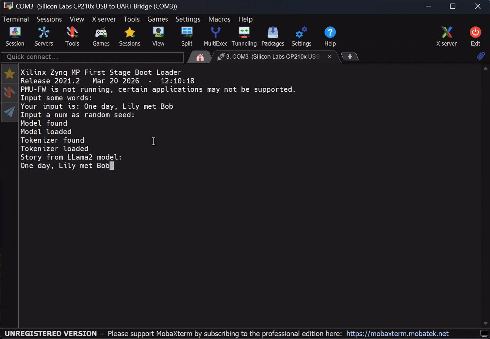

# LinGo

## Preparation

1. Install LLVM 15.0.6

```
cd LinGo

curl -L -O https://github.com/llvm/llvm-project/releases/download/llvmorg-15.0.6/llvm-project-15.0.6.src.tar.xz

mkdir -p llvm-project
tar -xf llvm-project-15.0.6.src.tar.xz \
    -C llvm-project \
    --strip-components=1

cmake -G Ninja \
    -S llvm-project/llvm \
    -B llvm-project/build \
    -DCMAKE_BUILD_TYPE=Release \
    -DLLVM_ENABLE_DUMP=ON \
    -DLLVM_TARGETS_TO_BUILD=X86 \
    -DCMAKE_INSTALL_PREFIX="$(pwd)/llvm-project/install" \
    -DLLVM_ENABLE_PROJECTS="clang"

ninja -C llvm-project/build -j 16
ninja -C llvm-project/build install
```

2. Conda env

```
conda create -n lingo python=3.12
conda activate lingo
conda install -c conda-forge openjdk=8 --no-update-deps
conda install -c conda-forge sbt --no-update-deps
pip install "cocotb~=1.9.2"
pip install cocotbext-axi
pip install numpy
```


3. Yosys download

```
curl -L -O https://github.com/YosysHQ/oss-cad-suite-build/releases/download/2026-10-02/oss-cad-suite-linux-x64-20261002.tgz

mkdir -p oss-cad-suite

tar -xf oss-cad-suite-linux-x64-20261002.tgz \
    -C oss-cad-suite \
    --strip-components=1
```

4. Install Verilator 5.044, and add to bashrc

```
git clone https://github.com/verilator/verilator.git
cd verilator
git checkout v5.044
autoconf
./configure
make -j8
export PATH=xxx/verilator/bin:$PATH
```

5. [Optional] MLIR Compiler support: Polygeist and LLVM18

```
git clone https://github.com/llvm/Polygeist.git
cd Polygeist
git submodule update --init --recursive --progress
cd llvm-project
cmake -G Ninja \
    -S llvm \
    -B build \
    -DCMAKE_BUILD_TYPE=Release \
    -DLLVM_ENABLE_DUMP=ON \
    -DLLVM_ENABLE_ASSERTIONS=ON \
    -DLLVM_ENABLE_RTTI=ON \
    -DLLVM_ENABLE_LIBEDIT=OFF \
    -DLLVM_TARGETS_TO_BUILD=X86 \
    -DLLVM_ENABLE_PROJECTS="clang;mlir" \
    -DCMAKE_INSTALL_PREFIX="$(pwd)/install"

ninja -C build -j 16
ninja -C build install

cd ..
mkdir build
cd build

cmake -G Ninja .. \
    -DMLIR_DIR=$PWD/../llvm-project/build/lib/cmake/mlir \
    -DCLANG_DIR=$PWD/../llvm-project/build/lib/cmake/clang \
    -DLLVM_TARGETS_TO_BUILD="host" \
    -DLLVM_ENABLE_ASSERTIONS=ON \
    -DCMAKE_BUILD_TYPE=DEBUG

ninja -j 16

```


## Build 

1. Build compiler

```
cd ./compiler
bash build.sh
```

2. Build mapper

```
cd ./mapper
bash build.sh
```

3. [Optional] Build MLIR compiler ADORA

```
cd LinGo
export ADORA_LLVM_ROOT="$(pwd)/Polygeist/llvm-project/install"
cd adora
cmake -S . -B build -G Ninja \
  -DCMAKE_BUILD_TYPE=Release \
  -DMLIR_DIR="$ADORA_LLVM_ROOT/lib/cmake/mlir" \
  -DLLVM_DIR="$ADORA_LLVM_ROOT/lib/cmake/llvm"

cmake --build build --target cgra-opt cgrv-opt adora-cdfg -j8
```

## Run

1. RTL hardware generate

```
cd ./hardware
conda activate lingo
bash genRTL.sh
bash export-cocotb.sh
```

2. Compile app

using LLVM compiler

```
cd ./benchmarks
cd [example]
../compile.sh [example] [kernel]
cd .. && ./dot2json.sh
```

or MLIR Compiler ADORA [Experimental]


```
cd ./benchmarks
cd [example]
../mlirCompile.sh [example]
```

3. Mapping

```
cd ./mapper
./run.sh [example] cocotb
cp ../benchmarks/[example]/xxx_cocotb.py ../simulation/workspace/[example].py
```

4. Verfication

First you need to write testbench like `simulation/workspace/test_cgra.py`

```
cd simulation
conda activate lingo
export PYTHONPATH=$(pwd)/server:$PYTHONPATH
export PYTHONPATH=$(pwd)/workspace:$PYTHONPATH
make [-j8]
```

## SoC Intergration

Integrates the LinGo CGRA into the [Cheshire](https://github.com/pulp-platform/cheshire) SoC as an external accelerator and runs bare-metal kernels in RTL simulation.

### Preparation

1. init Cheshire submodule 

```
cd LinGo
git submodule update --init soc/cheshire
git -C soc/cheshire submodule update --init sw/deps/printf
```

2. Install necessary python modules

```
conda activate lingo
pip install -r requirements.txt
```

3. Get bender v0.32.1

```
cd LinGo/soc
mkdir -p toolchain && cd toolchain
curl -L -O https://github.com/pulp-platform/bender/releases/download/v0.32.1/bender-x86_64-unknown-linux-gnu.tar.xz
tar -xf bender-x86_64-unknown-linux-gnu.tar.xz
cd bender-x86_64-unknown-linux-gnu && mv bender ../
ln -s "$(realpath bender)" "$CONDA_PREFIX/bin/bender"
```

4. Hardware dependencies (network needed)

```
cd LinGo/soc
bender checkout                 
bash util/get_sim_models.sh     
```

5. RISC-V bare-metal toolchain 

```
cd LinGo
git submodule update --init --recursive soc/toolchain/riscv-gnu-toolchain
cd soc/toolchain/riscv-gnu-toolchain

./configure \
    --prefix="$(pwd)/../riscv" \
    --with-arch=rv64gc \
    --with-abi=lp64d

make -j32
```

6. Proprietary tools, installed separately and on `PATH` — versions follow cheshire's docs ([sim](https://pulp-platform.github.io/cheshire/tg/sim/), [xilinx](https://pulp-platform.github.io/cheshire/tg/xilinx/)): QuestaSim `>= 2022.3` (validated: 2024.2); Vivado `>= 2020.2` for the FPGA flow only (validated: 2022.2).

### Build SoC simulator

1. Import LinGo hardware
```
cd LinGo/hardware && bash genRTL.sh
cd ../soc
bash util/sync_rtl.sh           
python3 util/gen_lingo_soc.py    
python3 util/gen_lingo_cfg.py [example]
# e.g. python3 util/gen_lingo_cfg.py gemm
```

2. Build

```
conda activate lingo
cd LinGo/soc/build
bash gen_vsim_do.sh
vsim -c -do "do lingo.vsim.do; quit"
```

[Notice]: if met problems like below from OpenTitan `regtool.py`

```
ModuleNotFoundError: No module named 'pkg_resources'
```

use `util/fix_pkgresource.sh`

3. Compile bare-metal application

First, you need to write apps like `soc/sw/tests/lingo_gemm.dram.c`

```
cd LinGo/soc
make -C sw lingo_spm.dram.elf lingo_gemm.dram.elf
```

### Run

```
cd LinGo/soc/build   
bash run_lingo.sh ../sw/tests/lingo_gemm.dram.elf   
```

Each test preloads the ELF into the DRAM model, releases the hart over JTAG, and prints PASS/FAIL over UART.

### License

Cheshire is SHL-0.51 (see `cheshire/LICENSE`); adapted sources retain their original headers. New files follow the license of the LinGo repository.

## ZYNQ FPGA Overlay demo

```
cd LinGo
git submodule update --init LinGo_FPGA_Prototype
```

and see `LinGo_FPGA_Prototype/README.md`

We achieved llama2 large language model inference acceleration on operator like `GEMV` and `RoPE`. 




## [Experimental] GUI flow

```
python3 LinGo/gui/server.py --port 8080
```

then visit localhost:8080


## Papers

```
@INPROCEEDINGS{ISCA26,
  author={Dai, Yuan and Zou, Guibin and Yang, Yuanda and Lin, Huan and Lou, Jiahang and Luo, Yiwen and Cai, Xinyu and Yin, Wenbo and Luk, Wai-Shing and Wang, Lingli},
  booktitle={2026 ACM/IEEE 53rd Annual International Symposium on Computer Architecture (ISCA)}, 
  title={Lora: Towards Improved Applicability of Reconfigurable Architecture for Versatile Nonlinear Functions}, 
  year={2026},
  volume={},
  number={},
  pages={825-841},
  doi={10.1109/ISCA66397.2026.00068}}

@ARTICLE{TC25,
  author={Dai, Yuan and Gao, Xuchen and Qiu, Yunhui and Li, Jingyuan and Cao, Yuhang and Mao, Yiqing and Chen, Sichao and Yin, Wenbo and Luk, Wai-Shing and Wang, Lingli},
  journal={IEEE Transactions on Computers}, 
  title={COFFA: A Co-Design Framework for Fused-Grained Reconfigurable Architecture Towards Efficient Irregular Loop Handling}, 
  year={2025},
  volume={74},
  number={9},
  pages={3099-3113},
  doi={10.1109/TC.2025.3585345}}

  @ARTICLE{11296830,
  author={Dai, Yuan and Gao, Xuchen and Lin, Huan and Yin, Wenbo and Luk, Wai-Shing and Wang, Lingli},
  journal={IEEE Transactions on Computer-Aided Design of Integrated Circuits and Systems}, 
  title={Dependency-Aware Data Parallelism on Spatial CGRA via Constraint Satisfaction and Graph Coloring}, 
  year={2026},
  volume={45},
  number={8},
  pages={3822-3835},
  doi={10.1109/TCAD.2025.3642732}}

  @INPROCEEDINGS{DAC25,
  author={Lou, Jiahang and Zhu, Qilong and Dai, Yuan and Zhong, Zewei and Yin, Wenbo and Wang, Lingli},
  booktitle={2025 62nd ACM/IEEE Design Automation Conference (DAC)}, 
  title={Adora Compiler: End-to-End Optimization for High-Efficiency Dataflow Acceleration and Task Pipelining on CGRAs}, 
  year={2025},
  volume={},
  number={},
  pages={1-7},
  doi={10.1109/DAC63849.2025.11132391}}

  @INPROCEEDINGS{ISCAS26,
  author={Lou, Jiahang and Zhang, Jianrong and Dai, Yuan and Zhong, Zewei and Lin, Huan and Yin, Wenbo and Wang, Lingli},
  booktitle={2026 IEEE International Symposium on Circuits and Systems (ISCAS)}, 
  title={Live Demonstration: An Agile FPGA-Overlayed CGRA SoC for High-Efficiency Computing}, 
  year={2026},
  volume={},
  number={},
  pages={1683-1683},
  doi={10.1109/ISCAS66217.2026.11562155}}

```