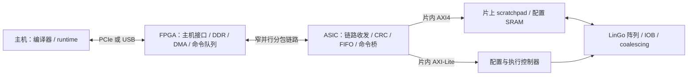

# LinGo ASIC + 外挂 FPGA 初步方案

本方案针对当前仓库默认架构，按首版验证芯片、优先降低实现风险规划。
工艺、封装、FPGA、核心频率和应用带宽尚未确定；以下频率与引脚数是设计预算，
不是已完成 STA、信号完整性分析或 SRAM 宏匹配后的承诺。本文不修改现有 RTL。

## 1. 当前设计与结论

`LinGoWithAXI.scala` 实际导出一个 AXI4 slave 和一个 AXI-Lite slave。
从 `simulation/circuits/LinGoWithAXI.v` 的顶层端口逐位统计：

| 接口 | 当前宽度 | 信号线数 |
| --- | --- | ---: |
| AXI4 | data/address/id = 128/16/8 bit | 402 |
| AXI-Lite | data/address = 32/7 bit | 102 |
| clock/reset | 各 1 bit | 2 |
| 合计 | 不含电源地、DFT、pad 等 | 506 |

这并不表示必须使用 506 个封装信号脚。建议把上述接口保留为 ASIC 内部接口，
新增 `LinGoAsicTop`，在 FPGA 和 ASIC 两侧实现窄链路和命令桥。
仅减少 AXI ID 或删除一些 sideband，无法解决两路 128-bit 数据总线的引脚开销。

默认 scratchpad 为 12 × 4 KiB 数据 bank，加 4 KiB 配置区，总计 52 KiB。
数据地址为 `0x0000..0xBFFF`，配置地址为 `0xC000..0xCFFF`。
当前 LinGo 通过 slave 接口接收外部搬运，未导出主动访问 FPGA DDR 的 AXI master。

## 2. 系统分工

FPGA 负责主机连接、外部 DDR、数据分块、DMA、命令调度、超时处理和调试工具。
ASIC 保留阵列、互连、IOB、scratchpad、配置控制器和执行控制器，新增链路桥、
时钟复位封装、pad ring、DFT 和状态寄存器。

片上 SRAM 应保留。把 bank 全部移到 FPGA 会使 IOB 的周期级访存跨芯片，
现有 SRAM 接口没有可变延迟 ready/valid 握手，需要重构调度及停顿机制。
FPGA DDR 用于存放大数据集，并按任务块搬入片上 SRAM。

## 3. 推荐链路与引脚预算

首版建议采用 **16-bit 每方向、两条单向通道、源同步 SDR**。
每个方向包含 `data[15:0]`、`valid` 和发送端转发时钟。
包头、包尾、CRC 和 credit 消息均在数据通道中传输；首版不引入双向数据脚换向。
8-bit 是引脚受限版本；32-bit 是带宽优先版本。

| 每方向宽度 | 双向链路脚数：2 × (W+2) | 加辅助信号后的初步预算 | 100 MHz SDR 单方向原始带宽 |
| ---: | ---: | ---: | ---: |
| 8 bit | 20 | 31 | 100 MB/s |
| 16 bit | 36 | 47 | 200 MB/s |
| 32 bit | 68 | 79 | 400 MB/s |

辅助信号预算为 11 脚：核心参考时钟 1、复位 1、IRQ 1、SPI 4、JTAG 4。
JTAG/SPI 角色需在 DFT 与启动架构中明确；额外 scan、test mode、strap、模拟测试脚
及差分时钟所需引脚另计。表中不含电源地和任何封装冗余，不能直接当作封装总脚数。
IRQ 与 SPI 为建议配置，均可按封装约束裁剪。

100 MHz 是估算点，必须由工艺 I/O cell、FPGA I/O、封装和 PCB 联合验证。
初次上电从低频开始；只有 SDR 完成验证后，再评估 DDR 或更高频率。
采用单端还是差分、具体 I/O 电压、驱动强度、终端和采样相位均需按库与板级条件确定。

源同步并不免除时序约束：需要建立 FPGA output/input delay、ASIC 外部时序预算、
clock/data skew 和板级走线约束。接收端需满足建立/保持时间；不能假定同沿发送、
同沿接收自然成立。核心域与链路接收域通过经过验证的异步 FIFO 交互，复位解除按域同步。

credit 不能依赖组合 ready 信号穿过 PCB。接收端按可用缓冲空间授信，发送端只在
credit 足够时发送；协议保留控制消息资源，避免两个方向的数据同时耗尽信用而死锁。
FIFO 深度应覆盖 credit 往返延迟、在途数据及已授予但尚未使用的信用。

## 4. 命令协议与片内桥

推荐传输“内存/CSR 事务”，由 ASIC 本地生成 AXI 握手。
保留软件可见地址映射，不要求外部逐周期复现五个 AXI 通道。

建议第一版命令集：

| 命令 | 行为 |
| --- | --- |
| MEM_WRITE | 向 scratchpad/配置区写一段数据，完成后返回状态 |
| MEM_READ | 读取一段数据，响应携带数据与状态 |
| CSR_WRITE / CSR_READ | 访问现有 AXI-Lite CSR |
| FENCE | 确认此前写入已获得本地 AXI B 响应，供后续启动操作排序 |
| STATUS | 读取链路、桥、配置/执行 busy/done 和错误状态 |

包格式建议包含版本、opcode、序号、目标空间、字节地址、字节长度、payload 与 CRC。
字段宽度、字节序、CRC 多项式、最大 payload 和 credit 单位需在实现前冻结。
建议先支持 256~1024 byte payload、16-byte 对齐整 beat 数据，CSR 为 32-bit。
未支持的对齐、长度或地址必须明确拒绝，不能静默截断；部分写在需要时以 byte mask 扩展。

桥接端把 16-bit payload 拼接为 128-bit AXI beat，读取方向反向拆分。
首版严格按事务顺序执行，使用固定 AXI ID；可以缓冲多个包，但同一时刻只提交一个
本地事务。根据现有引擎实际支持范围选择 AXI burst，默认使用整 beat INCR；
分割 burst 时遵守 4 KiB 边界、bank 边界和 AXI 长度上限。
不能把当前 AXI ID 为 8 bit 理解成引擎支持 256 个 outstanding。

写包建议先完整缓冲并验证 CRC，再提交 AXI，避免坏包引起部分写入。
响应中的成功表示本地事务完成，不只是包已入 FIFO。AXI 错误、非法地址、
超时和链路错误分别报告。读响应也进行 CRC 校验。

包含启动副作用的 CSR 写不能在响应丢失后直接重试。使用事务序号和去重/完成状态，
或先查询状态再恢复。链路重连不能让半包变成有效命令；须定义会话复位、信用重建、
在途事务清理以及不确定完成事务的处理。首版不必做透明自动重放。

SPI 可作为独立低速恢复通道，访问 chip ID、状态和 CSR；如要求主链路故障时仍能
运行最小 kernel，则 SPI 还需具备内存上传/回读能力。SPI 与主链路访问通过同一桥仲裁。
JTAG 的 DFT 访问与功能调试访问分别定义，不能默认 JTAG 自带完整内存访问功能。

## 5. 首版执行流程和性能判断

首版先采用：上传配置与输入 → 等待写完成 → 启动配置 → 等待配置完成 → 启动执行
→ 等待执行完成 → 回读输出。

当前 `ConfigController` 有 done，但 `LinGoController` 尚未把该状态暴露为 CSR。
建议新增 cfg_busy/cfg_done，以及 exe_busy、chip ID/version、错误状态和周期计数器。
既有 CSR 地址保持兼容，新增寄存器放入独立扩展区，生成规格同步更新。
IRQ 建议采用可清除的粘滞事件状态，并区分执行完成和错误；轮询作为后备路径。

首版运行时禁止修改活跃 bank 和配置区，广播写也只在安全阶段使用。
主链路回压只影响装载/回读，执行期间阵列使用片上 SRAM。
之后若需 load/compute/store 重叠，可在各 bank 划分两块区域并明确 ownership；
这需要验证容量、地址调度、宏端口、广播冲突和 coalescing，不能仅增加 FIFO 就宣称支持。

性能估算采用十进制 MB/s：

`B_raw = W/8 × f_link × (SDR: 1；DDR: 2)`

`B_effective = B_raw × η`

`T_task ≈ (D_cfg + D_in)/B_write + T_cfg + T_compute + D_out/B_read + T_control`

例如 16-bit、100 MHz SDR、假设综合效率 η=0.8，对应约 160 MB/s 有效带宽。
48 KiB 输入单独装载约需 307 μs；等量输出再需约 307 μs。η 是假设，需测量确认。
对于每次仅计算几十微秒且数据复用低的任务，链路将主导端到端性能。
扩大包长、批量提交、复用配置/权重和双缓冲应以实际 workload 数据验证收益。

128-bit 片内接口在 200 MHz 下理想每周期一 beat 为 3.2 GB/s，代表接口理论量级，
不代表现有实现的持续吞吐或读写可同时达到该值。窄链路与多 bank 内部带宽不同；
FPGA DDR 即使很快，也不能消除 FPGA—ASIC 链路瓶颈。

## 6. SRAM 宏是前期决策条件

现有 `TrueDualPortSRAMAsym(128, 8, 32, ...)` 在默认 bank 中拆成四个
`TrueDualPortSRAM(32, 8, ...)`，即每个 bank 四块 256×32 双读写端口存储。
12 个数据 bank 共 48 个这样的逻辑实例，配置区另为 256×128 双端口存储。
这里是逻辑组织，最终物理宏数可能不同。

`TARGET_TYPE` 当前默认 `TARGET_SIM`。切换至 ASIC 会生成通用 `dp_sram_*_ip`
black box，但仓库中的这些名称并不是已经绑定、可流片的工艺 SRAM 宏。
需要为最终宏提供功能 wrapper、仿真模型及综合/物理视图，并核对掩码极性、
读延迟、时钟和同址读写行为。

优先检查工艺是否提供带 byte mask 的 2RW 宏。若只能取得 1RW 或 1RW1R 宏，
不能直接替换并维持两侧任意并发写语义。首版可评估阶段复用单端口 SRAM：
装载/回读阶段交给外部桥，执行阶段交给 IOB，配置阶段交给配置控制器。
该方案需要硬件 ownership、busy 拒绝/排队和适配验证，且会限制重叠传输。
避免未经面积评估将 52 KiB scratchpad 全部实现成触发器。

还需盘点配置存储、延迟队列、寄存器文件等其他存储，实现与面积单独评估。
SRAM BIST、scan/test 模式与测试引脚预算应在封装定案前完成。

## 7. 实施顺序与验收

1. 确定工艺、可用 SRAM/IO 宏、封装信号脚、目标 workload 的输入/输出量和计算时间。
   在该阶段选择 8/16/32-bit 与存储端口方案。
2. 冻结包协议、地址映射、信用规则、复位恢复和桥支持的 AXI 子集，建立 ASIC shell。
   现有 `LinGoWithAXI` 继续作为内部核与原有仿真入口。
3. 使用两块 FPGA或一块 FPGA 内两套端点验证协议与 runtime；跨板验证真实链路时序，
   在核模型/FPGA 原型上跑实际 kernel 并测得有效吞吐。
4. 完成 SRAM 绑定、pad/clock/reset/DFT 集成，以及综合、CDC/RDC、STA 和物理实现。
   对链路做回压、CRC 错误、响应丢失、复位半包、非法地址和超时故障验证。
5. 上电顺序为低速识别 → 链路自检 → SRAM BIST/读写 → 配置完成检查 → 最小 kernel
   → 完整 benchmark。分别报告核心计算时间与端到端时间。

备选：若只要求功能验证且引脚极少，可只使用 SPI，带宽按所定时钟和协议估算。
若需要持续 GB/s 级端到端吞吐，再考虑更宽并行/DDR，或有明确工艺 PHY 与许可支持的
高速串行链路。FPGA 的高速收发器并不能替代 ASIC 端的 PHY。

## 8. 参考与适用边界

AMD 的 AXI Chip2Chip 文档展示了通道复用、宽度转换及公共/独立时钟下的桥接思路：
[General Design Guidelines, PG067](https://docs.amd.com/r/en-US/pg067-axi-chip2chip/General-Design-Guidelines)。
本文参考其架构思想，采用自定义事务协议；该 FPGA IP 的可用性不能作为 ASIC 工艺
实现和授权已具备的依据。
